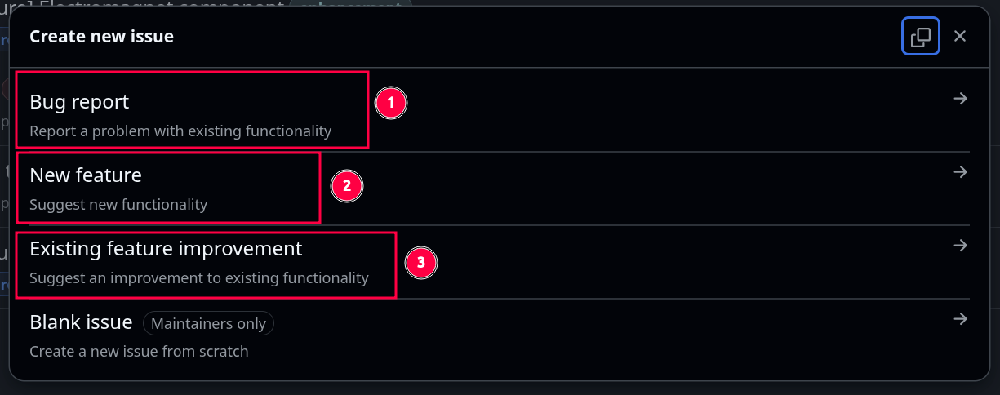
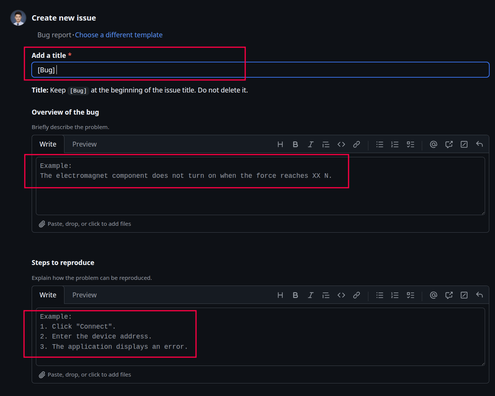
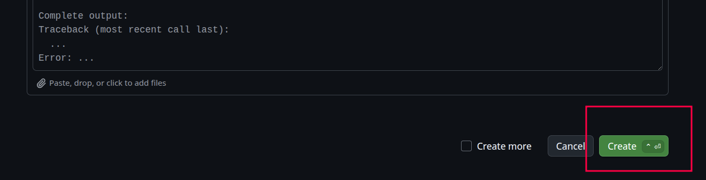
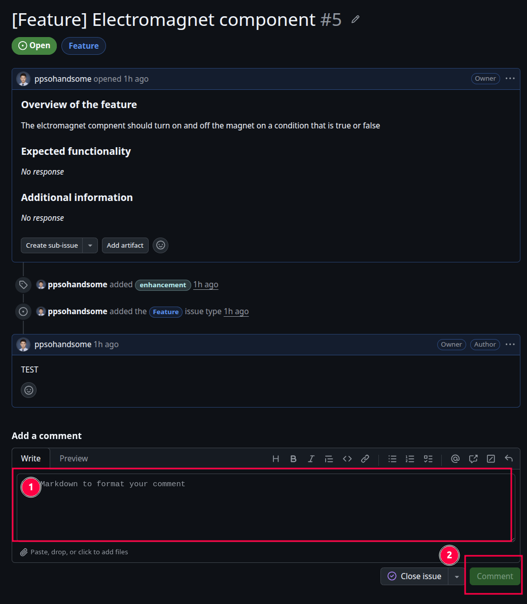

# How to write an issue

1. Open the **Issues** tab at the top of the repository page.

2. Click **New issue** in the upper-right corner.

   

3. Choose one of the three issue types:

   

   - **Bug report**: Use this when existing functionality does not work as expected, produces an error, or behaves incorrectly.

   - **Existing feature improvement**: Use this when an existing feature works but should be faster, clearer, more reliable, or otherwise improved.

   - **New feature**: Use this when you want to propose functionality that does not currently exist.

4. Complete the fields in the selected form. Each form includes examples to show what kind of information to provide.

   

5. Create the issue.

   

After an issue has been created, open it to read updates and post comments. Comments can be used to answer questions, discuss possible solutions, share progress, and provide additional logs, screenshots, videos, or documents.

