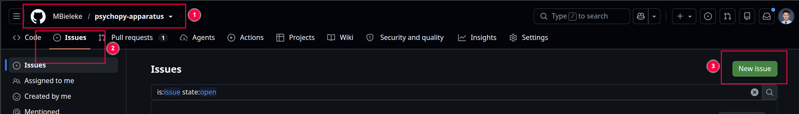

# How to write an issue

1. Open the **Issues** tab at the top of the repository page.

2. Click **New issue** in the upper-right corner.

   

3. Choose one of the three issue types:

   

   - **Bug report**: Use this when existing functionality does not work as expected, produces an error, or behaves incorrectly.
     Complete these fields:
     - **Overview of the bug**: Briefly describe the problem.
     - **Steps to reproduce**: Explain how the problem can be reproduced.
     - **Expected result**: Explain what you expected to happen instead.
     - **Error logs or screenshots**: Provide the complete command, full error output, screenshots, or other useful evidence.

   - **Existing feature improvement**: Use this when an existing feature works but should be faster, clearer, more reliable, or otherwise improved.
     Complete these fields:
     - **Overview**: Describe the existing functionality that should be improved.
     - **Desired change**: Explain how you would like the functionality to change.
     - **Additional information**: Add mockups, examples, links, or other useful context.

   - **New feature**: Use this when you want to propose functionality that does not currently exist.
     Complete these fields:
     - **Overview of the feature**: Briefly describe the new feature.
     - **Expected functionality**: Explain how you expect the feature to work.
     - **Additional information**: Add supporting videos, documents, diagrams, links, or other useful context.

4. Complete the fields in the selected form. Each form includes examples to show what kind of information to provide. Replace the examples with information about your issue.

5. Submit the issue.

After an issue has been created, open it to read updates and post comments. Comments can be used to answer questions, discuss possible solutions, share progress, and provide additional logs, screenshots, videos, or documents.
